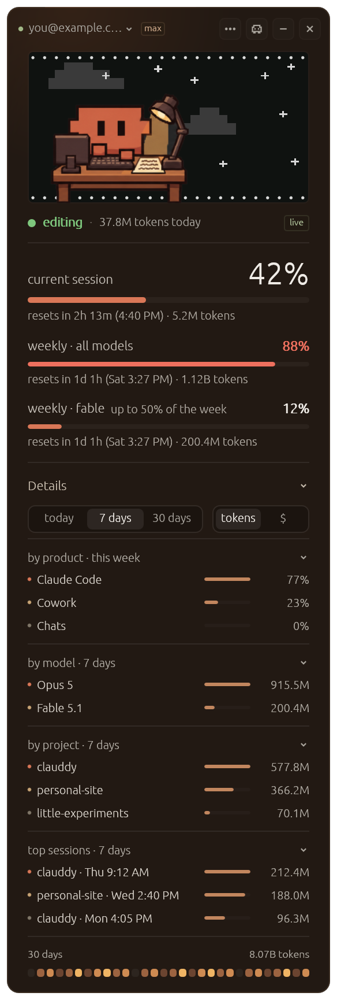
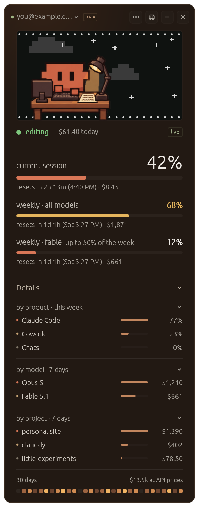
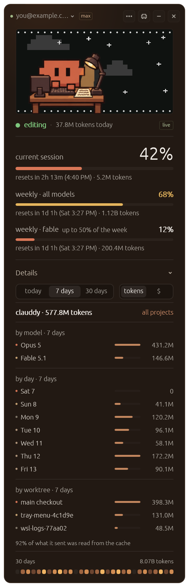
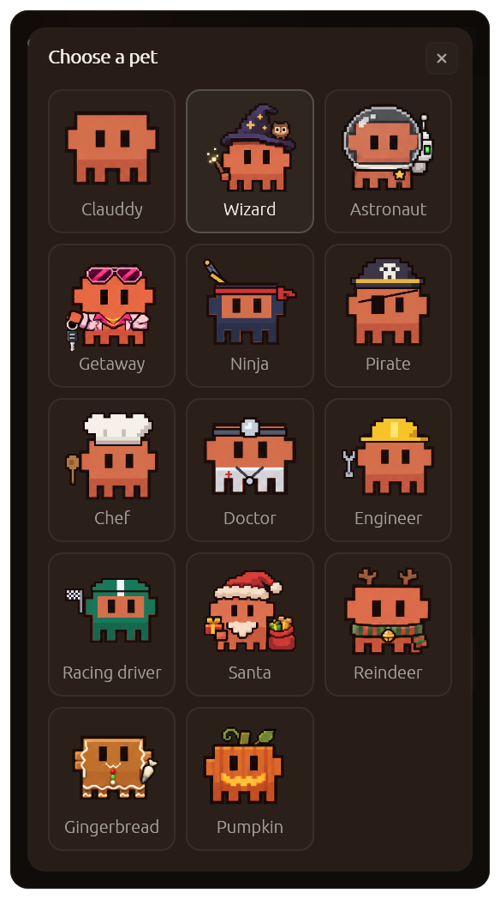

# Clauddy — what your Claude Code usage is worth

A pixel-art desktop pet that watches your Claude Code usage: the real session and weekly % from your account, the tokens from your local logs, and now **what they would have cost on the API, project by project and session by session**. It works, sleeps and catches fire along with you.

> This is a fork of [renatoaug/claude-usage-monitor](https://github.com/renatoaug/claude-usage-monitor), the original Clauddy. It keeps everything the original does and adds the API value, per-repository projects, top sessions and six new pets.

<p align="center">
  <a href="#whats-new-in-this-fork">What's new</a> ·
  <a href="#install">Install</a> ·
  <a href="docs/design/02-features.md">Features</a> ·
  <a href="docs/design/01-architecture.md">Architecture</a> ·
  <a href="docs/decisions/">Decisions</a>
</p>

<p align="center">
  
</p>

## What's new in this fork

### What the usage is worth

**tokens / $**, under Details, switches every count to what it would have cost on the API: today, the session, the week, each model, each project, each session. Over 30 days it also reads as a multiple of what the plan costs (`$13.5k, 67 times the plan`). The prices are built in (Anthropic's), and `~/.claude-usage-monitor/prices.json` adds a model or corrects a price without a new build ([usage](docs/design/04-usage.md#api-value), [ADR-018](docs/decisions/ADR-018-api-value-from-a-price-list.md), [ADR-019](docs/decisions/ADR-019-the-price-list-can-be-corrected.md)).

### Projects by repository, and a project in detail

Projects are grouped by repository: a session started in a subdirectory or in a worktree counts for the repository it belongs to, instead of showing up as a project of its own. A click on a project opens it: its models, its last 7 days, its worktrees and how much of what it sent was read from the cache ([usage](docs/design/04-usage.md#projects)).

### Top sessions over a span

**today**, **7 days** or **30 days** sets what the lists cover, and **top sessions** ranks the five heaviest of the span, by tokens or by API value ([usage](docs/design/04-usage.md#spans-a-project-in-detail-sessions)).

| API value | A project in detail |
|---|---|
|  |  |

### Six more pets

Ninja, pirate, chef, doctor, engineer and a racing driver in a race car join the wizard, the astronaut, the getaway pet and the holiday packs: fourteen pets in all, each with every mood. **Change pet**, in the title band's menu, switches at once ([pets](docs/design/06-pets.md)).

<p align="center">
  
</p>

### Updates come from this fork

The update check and `install.sh` read this fork's releases, so accepting an update never replaces it with the original's build.

## What Clauddy does

- **The real limits**: the session and weekly % from your Claude account, with each reset time, a model's own weekly limit and what each product (Claude Code, Cowork, Chats) took of the week
- **The tokens from your logs**: by model, by project, by day, with a 30-day heat map and the pace you are burning at
- **A pet with moods**: idle, working at its desk while a turn is open, on fire past 90%, maxed out at 100%, asleep after 5 idle minutes; it speaks up when something changes
- **Three sizes**: expanded, compact, or just the pet with a speech bubble of your usage; floating or in the menu bar
- **Alerts**: a notification past a threshold, and a one-shot reminder when the session resets
- **Several accounts**, switched from the title band

Everything is in [`docs/design/02-features.md`](docs/design/02-features.md).

## Install

This fork has no release of its own yet, so its additions are built from the code. You need [Rust](https://rustup.rs).

**macOS (Apple Silicon)**, as an app:

```bash
git clone https://github.com/JalelTounsi/claude-usage-monitor
```

```bash
cd claude-usage-monitor/native && scripts/bundle.sh && open target/Clauddy.app
```

**Windows (x64) and Linux (x64)**, from `native/`:

```bash
cargo run --release
```

The original's release, without this fork's additions, runs anywhere with `bunx clauddy` ([Bun](https://bun.sh), or `npx` with Node 18+). [`docs/design/03-setup.md`](docs/design/03-setup.md) has the details for each platform and every setting in `config.json`; its install commands are the original's.

### Requirements

- macOS on Apple Silicon (the first-class build), Windows x64 or Linux x64
- [Claude Code](https://claude.com/claude-code), whose logs in `~/.claude/projects` give the token counts; a Claude login, done once in Settings, gives the real %

## Development

A native app in Rust with egui, no browser engine: about 1–2% CPU and a 20 MB app ([stack](docs/design/01-architecture.md#stack)).

```bash
cd native
cargo fmt --check                                     # formatting
cargo clippy --release --all-targets -- -D warnings   # lint
cargo test --release                                  # unit tests and the snapshot gallery
CLAUDDY_STATE=fire cargo run --release                # force a mood: idle, working, fire, tired, sleeping
```

The snapshot gallery renders every screen state into [`native/tests/snapshots/`](native/tests/snapshots/), where every picture in this README comes from; after an intended visual change, `UPDATE_SNAPSHOTS=1 cargo test --release` rewrites it. At the root, `bun run test` tests the npm launcher. Code rules and the checks before a change is done are in [`AGENTS.md`](AGENTS.md); commits follow [Conventional Commits](https://www.conventionalcommits.org).

## Releases

A merge to `main` can be a release: [semantic-release](https://semantic-release.gitbook.io) reads the commit titles since the last tag (a `feat` bumps the minor, a `fix` or `perf` the patch), builds the app on macOS, Windows and Linux, and publishes the GitHub release ([`docs/design/07-releases.md`](docs/design/07-releases.md)).

## Privacy

Everything stays on your machine, in `~/.claude-usage-monitor/`. Nothing leaves it except the OAuth and usage calls to Anthropic and, with Cursor connected, the usage calls to Cursor with the Cursor app's own token. The API value is computed locally from the built-in price list. What is kept and what is read: [`docs/design/01-architecture.md`](docs/design/01-architecture.md#data-on-disk).

## Credits

Clauddy was created by [@renatoaug](https://github.com/renatoaug): the pet, the app and most of what is here come from [the original](https://github.com/renatoaug/claude-usage-monitor), where bugs and ideas that aren't specific to this fork belong. This fork is maintained by [@JalelTounsi](https://github.com/JalelTounsi). Pull requests are welcome: [`CONTRIBUTING.md`](CONTRIBUTING.md) says how to start.

## License

[MIT](LICENSE), like the original.
